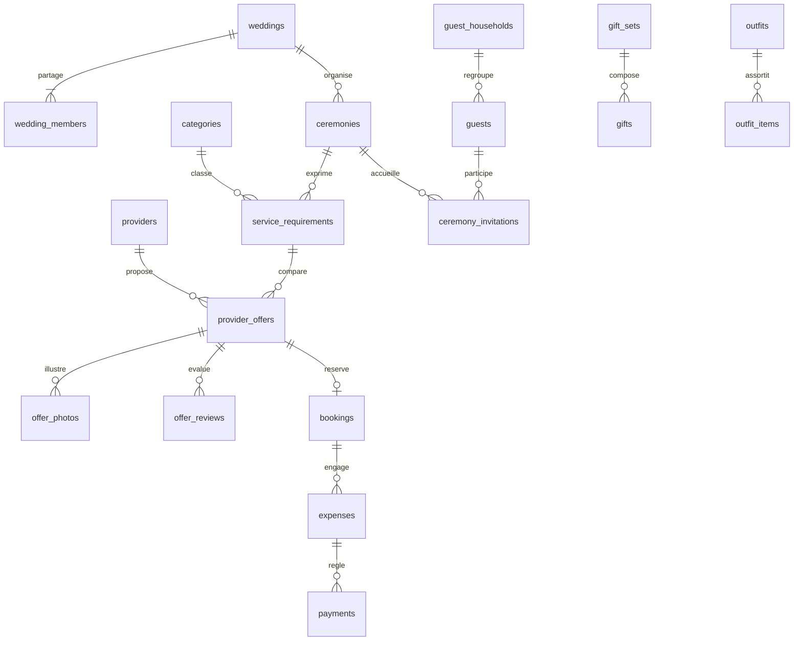

# Modèle relationnel

Toutes les données métier portent wedding_id. Une clé unique (wedding_id,id) et des FK composites empêchent les liens entre deux mariages. UUID pour les identifiants, timestamps, index wedding_id, suppression explicite des parents avec dépendances. Les photos doivent être retirées via Storage avant leur métadonnée ; aucune cascade SQL ne supprime un fichier Storage.

Les avis appartiennent à leur auteur ; les autres membres peuvent les lire. Comparaisons : en-tête + lignes d'offres ; les critères et poids extensibles sont JSONB. Dfou3 et tenues sont des achats prévisionnels, jamais automatiquement comptés dans les dépenses. Les paiements héritent de la devise et de la cérémonie de la dépense. Transaction et verrou de ligne empêchent les dépassements concurrents.

Création du mariage, génération et acceptation d'invitation passent par RPC security definer à search_path vide. Appartenance non éditable côté client. Token aléatoire 256 bits, uniquement son SHA256 stocké, expiration 48h, adresse vérifiée, deux comptes maximum. Les tables invitations n'ont aucun accès direct client.

Migrations : `001_initial.sql`, `002_decisions.sql`, `003_media.sql`, `004_wedding_extensions.sql`, dans cet ordre sur un projet vierge. Sur une base à jour en 003, appliquer uniquement 004. Ne pas rejouer sans restauration/migration dédiée. `service_requirements.selected_offer_id` conserve une décision commune unique et réversible, indépendante de `bookings`. Les médias des ensembles Dfou3, tenues et inspirations utilisent des pièces jointes à cible unique et des FK typées. Les RPC de sélection et réservation sont transactionnelles ; la limite de quatre offres et l'appartenance au même besoin sont également contrôlées en base.

## Extensions Jhaz, moodboards et déroulement

- `trousseau_categories` : catégories libres avec enveloppe prévue MAD ; `trousseau_sets` : ensembles assortis ; `trousseau_items` : quantité, prix unitaire/devise, statut, responsable et FK fournisseur/ensemble/catégorie/dépense. `expense_id` est unique pour empêcher le comptage d'une même facture sur deux articles ; regrouper une facture multiarticles dans un article récapitulatif si nécessaire. La suppression d'un article conserve la dépense et ses paiements.
- `moodboards` : nom, description, thème et cérémonie facultative. `inspirations` est étendue, sans remplacement de table : moodboard, couleurs, source HTTPS, description, thème, position et FK offre/tenue/tâche en plus des anciennes relations. `inspiration_comments` : texte et auteur ; seul l'auteur peut modifier son commentaire, les deux membres peuvent lire.
- `timeline_events` : heures stockées en minutes relatives au jour de cérémonie, fin strictement après début, statut, ordre, offre et notes internes/publiques séparées. `timeline_event_providers` : relation N–N vers les prestataires réutilisés. La proposition liée doit concerner la même cérémonie. `reorder_timeline`, `reorder_moodboard` et `save_timeline_event` réalisent des écritures transactionnelles soumises à RLS.
- `attachments` : nouvelles FK `trousseau_item_id` et `trousseau_set_id`. Une seule cible par pièce jointe ; clés composites et bucket privé inchangés. Les galeries et sauvegardes sont réutilisées.
- `categories.kind` identifie les modèles Makeup, Hair et véhicule ; `parent_name` décrit Beauté ou Transports. Les catégories anciennes sont conservées. `provider_offers.package_reference` relie conceptuellement deux offres beauté distinctes sans créer d'engagement.

Toutes les nouvelles tables portent wedding_id, UUID, timestamps, index et RLS par appartenance. Les FK vers les données métier incluent wedding_id. Aucun endpoint anonyme de lecture du programme ou des photos n'est ajouté.
